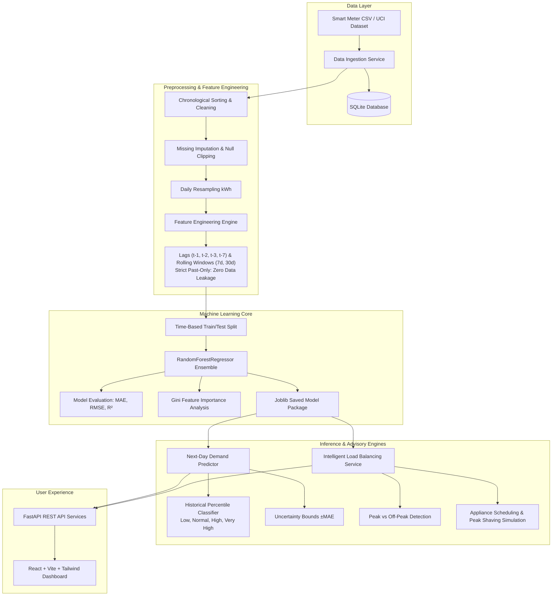

# SmartGrid AI – Intelligent Household Power Demand Prediction & Load Balancing System

> An enterprise-grade, industry-level intelligent energy analytics application powered by **Random Forest Machine Learning** to forecast next-day household electricity consumption and optimize load balancing.

---

## 1. System Architecture



---

## 2. Technology Stack

### Frontend:
- **Framework:** React.js (v18) with Vite
- **Styling:** Tailwind CSS (Navy / Charcoal / Electric Blue / Emerald Green dark SaaS theme)
- **Routing:** React Router DOM (v6)
- **Data Visualization:** Recharts (Area, Bar, and Line charts)
- **Icons:** Lucide React
- **HTTP Client:** Axios

### Backend:
- **API Framework:** FastAPI with Uvicorn
- **Data Science:** Pandas & NumPy
- **Machine Learning:** Scikit-Learn (`RandomForestRegressor`)
- **Model Serialization:** Joblib
- **Database:** SQLite3 (native persistence)
- **Data Validation:** Pydantic (v2)

---

## 3. Machine Learning Formulation & Zero Data Leakage

### Feature Engineering
For predicting demand on day $t$, **only observations from days prior to $t$ are utilized** ($t-1, t-2, \dots$):

1. **Lags:**
   - $\text{lag}_1 = y_{t-1}$ (Previous day consumption)
   - $\text{lag}_2 = y_{t-2}$ (Previous 2-day consumption)
   - $\text{lag}_3 = y_{t-3}$ (Previous 3-day consumption)
   - $\text{lag}_7 = y_{t-7}$ (Previous 7-day consumption)
2. **Rolling Statistics:**
   - $\text{rolling\_mean}_7 = \frac{1}{7} \sum_{i=1}^{7} y_{t-i}$
   - $\text{rolling\_mean}_{30} = \frac{1}{30} \sum_{i=1}^{30} y_{t-i}$
   - $\text{rolling\_max}_7 = \max(y_{t-1}, \dots, y_{t-7})$
   - $\text{rolling\_min}_7 = \min(y_{t-1}, \dots, y_{t-7})$
3. **Temporal Features:**
   - Day of month ($1-31$), Month ($1-12$), Day of week ($0-6$), Weekend indicator ($\{0, 1\}$).
4. **Demand Categorization:**
   - **Low Demand:** $\le P_{25}$
   - **Normal Demand:** $(P_{25}, P_{75}]$
   - **High Demand:** $(P_{75}, P_{90}]$
   - **Very High Demand:** $> P_{90}$
5. **Uncertainty Bounds:**
   - Forecast reported as $[\hat{y} - \text{MAE}, \hat{y} + \text{MAE}]$, representing empirical holdout validation error without misleading probability estimates.

---

## 4. Application Modules

| Module | Description | Route |
| :--- | :--- | :--- |
| **Module 1: Landing Page** | Enterprise presentation page with branding, hero section, features, architecture, and workflow overview. | `/` |
| **Module 2: Main Dashboard** | Real-time KPI cards (Today kWh, Tomorrow predicted, Avg kWh, Peak kW, Model R²), trend charts, and recent predictions. | `/dashboard` |
| **Module 3: Data Upload** | Drag-and-drop CSV upload, validation, UCI Household compatibility, downloadable template, and 1-click 120-day demo dataset. | `/upload` |
| **Module 4: Preprocessing** | Pandas cleaning pipeline (null imputation, deduplication, non-negative clipping, and daily kWh resampling). | `/preprocessing` |
| **Module 5 & 6: Model Training** | Configurable Random Forest hyperparameter tuning, chronological train/test split, MAE/RMSE/R² metrics, and feature importance. | `/training` |
| **Module 7: Next-Day Prediction** | Primary forecast engine: target date selection, percentile tier classification, uncertainty interval, and comparison charts. | `/predict` |
| **Module 8: Load Balancing** | Peak window detection, flexible load shifting simulation (pre vs post curves), and actionable appliance scheduling. | `/load-balancing` |
| **Module 9: Energy Insights** | Behavioral patterns, weekend vs weekday comparisons, anomaly detection ($>2\sigma$), and tariff billing projections. | `/insights` |
| **Module 10: Prediction History** | Persistent SQLite prediction audit log with search, category filtering, sorting, and historical timeline chart. | `/history` |
| **Module 11: Settings** | Household profile, electricity tariff ($/kWh), peak threshold, and active dataset configuration. | `/settings` |

---

## 5. Getting Started & Execution

### Prerequisites:
- Python 3.10+
- Node.js v18+ & npm

### Backend Setup:
```bash
# 1. Navigate to backend directory
cd backend

# 2. (Optional) Create and activate virtual environment
python -m venv venv

# Windows Activation:
venv\Scripts\activate
# Linux/macOS:
source venv/bin/activate

# 3. Install dependencies
pip install -r requirements.txt

# 4. Start the FastAPI server
uvicorn app.main:app --reload --port 8000
```
- **Backend API:** `http://127.0.0.1:8000`
- **Swagger Documentation:** `http://127.0.0.1:8000/docs`

---

### Frontend Setup:
```bash
# 1. Open a new terminal in the frontend directory
cd frontend

# 2. Install dependencies
npm install

# 3. Start Vite development server
npm run dev
```
- **Frontend Application:** `http://localhost:5173`

---

## 6. API Reference

| Method | Endpoint | Description |
| :--- | :--- | :--- |
| `GET` | `/api/health` | Health check, active model status, and dataset count |
| `POST` | `/api/upload` | Upload and validate smart-meter CSV |
| `POST` | `/api/upload/demo` | Load 120-day realistic UCI Household demo dataset |
| `GET` | `/api/template` | Download sample CSV template |
| `GET` | `/api/datasets` | List all ingested datasets |
| `GET` | `/api/dataset/preview` | Preview raw dataset rows and column statistics |
| `GET` | `/api/dataset/summary` | Summary metadata for active dataset |
| `POST` | `/api/preprocess` | Execute multi-stage Pandas preprocessing pipeline |
| `POST` | `/api/train` | Train Random Forest Regressor with hyperparameters |
| `GET` | `/api/model/metrics` | Retrieve active model MAE, RMSE, and R² scores |
| `GET` | `/api/model/feature-importance` | Retrieve sorted Gini feature importances |
| `POST` | `/api/predict/next-day` | Predict next-day power demand and categorize tier |
| `GET` | `/api/dashboard/summary` | Retrieve KPI card telemetry and summary stats |
| `GET` | `/api/dashboard/consumption-trend` | Retrieve daily, weekly, or monthly trend series |
| `GET` | `/api/load-balancing` | Retrieve 24-hr peak curves and appliance schedules |
| `GET` | `/api/insights` | Retrieve extremes, anomalies, and cost analytics |
| `GET` | `/api/history` | Retrieve stored prediction records with search & filters |
| `DELETE` | `/api/history/{id}` | Delete a prediction record from SQLite |
| `GET` | `/api/settings` | Retrieve household profile and tariff configuration |
| `PUT` | `/api/settings` | Update household profile and tariff in SQLite |

---

## 7. Project Structure

```
household_project/
├── backend/
│   ├── app/
│   │   ├── main.py                  # FastAPI application entrypoint & routing
│   │   ├── api/                     # REST API modular endpoints
│   │   │   ├── dashboard.py         # Dashboard KPI & trend endpoints
│   │   │   ├── history.py           # SQLite prediction history endpoints
│   │   │   ├── insights.py          # Behavioral energy insights endpoints
│   │   │   ├── load_balancing.py    # Load balancing advisory endpoints
│   │   │   ├── prediction.py        # Next-day demand forecasting endpoints
│   │   │   ├── preprocessing.py     # Pandas cleaning & resampling endpoints
│   │   │   ├── settings.py          # Household settings endpoints
│   │   │   ├── training.py          # Model training & hyperparameter endpoints
│   │   │   └── upload.py            # File ingestion & demo dataset endpoints
│   │   ├── database/                # Database models & connections
│   │   │   └── database.py          # SQLite schema & table initialization
│   │   ├── services/                # Business & Machine Learning logic
│   │   │   ├── data_service.py      # Dataset storage & demo generator
│   │   │   ├── feature_engineering.py # Lag & rolling window calculations
│   │   │   ├── load_balancing_service.py # Peak detection & load shifting
│   │   │   ├── model_service.py     # Random Forest training & evaluation
│   │   │   ├── prediction_service.py # Inference & percentile categorization
│   │   │   └── preprocessing_service.py # Data normalization & daily totals
│   │   ├── utils/                   # Validation & mathematical metrics
│   │   │   ├── metrics.py           # MAE, RMSE, R², MAPE calculators
│   │   │   └── validators.py        # CSV format detection & checks
│   │   └── saved_models/            # Serialized model packages (.pkl)
│   ├── data/                        # SQLite DB & storage uploads
│   │   ├── smartgrid.db
│   │   ├── sample/
│   │   └── uploads/
│   └── requirements.txt             # Python dependencies
├── frontend/
│   ├── src/
│   │   ├── components/              # UI components
│   │   │   ├── AlertBanner.jsx
│   │   │   ├── EmptyState.jsx
│   │   │   ├── Header.jsx
│   │   │   ├── KPICard.jsx
│   │   │   ├── LoadingSpinner.jsx
│   │   │   └── Sidebar.jsx
│   │   ├── pages/                   # Application views
│   │   │   ├── DashboardPage.jsx
│   │   │   ├── DataUploadPage.jsx
│   │   │   ├── EnergyInsightsPage.jsx
│   │   │   ├── HistoryPage.jsx
│   │   │   ├── LandingPage.jsx
│   │   │   ├── LoadBalancingPage.jsx
│   │   │   ├── ModelTrainingPage.jsx
│   │   │   ├── PredictionPage.jsx
│   │   │   ├── PreprocessingPage.jsx
│   │   │   └── SettingsPage.jsx
│   │   ├── services/
│   │   │   └── api.js               # Axios API client
│   │   ├── App.jsx                  # React routing & layout
│   │   ├── index.css                # Tailwind directives & dark theme
│   │   └── main.jsx                 # React root DOM mount
│   ├── package.json
│   ├── tailwind.config.js
│   └── vite.config.js
├── README.md                        # Documentation
└── test_all_endpoints.py            # Automated API verification test suite
```

---

## 8. Verification & Demonstration Guide

1. **Start the backend:** `uvicorn app.main:app --reload --port 8000`
2. **Start the frontend:** `npm run dev` in `frontend/`
3. **Open:** `http://localhost:5173`
4. Click **Get Started** or navigate to **Data Upload**:
   - Click **Load 120-Day Demo Dataset** (or upload your own CSV).
5. Navigate to **Preprocessing**:
   - Review missing value handling and click **Run Preprocessing Pipeline**.
6. Navigate to **Model Training**:
   - Configure estimators (e.g. 100), max depth (12), and click **Train Random Forest Model**.
   - Review the MAE, RMSE, R² score, holdout line chart, and Gini feature importance bar chart.
7. Navigate to **Next-Day Prediction**:
   - Click **Predict Next-Day Demand** to obtain the forecasted kWh, demand tier badge, percentage trend, and peak window.
8. Navigate to **Load Balancing**:
   - Observe baseline vs. optimized simulated load curves and appliance scheduling suggestions.
9. Navigate to **Energy Insights**:
   - Analyze weekday vs. weekend loads, unusual spike anomalies, and adjust the tariff rate per kWh.
10. Navigate to **Prediction History**:
    - Filter and search through all persistent SQLite forecasts.

